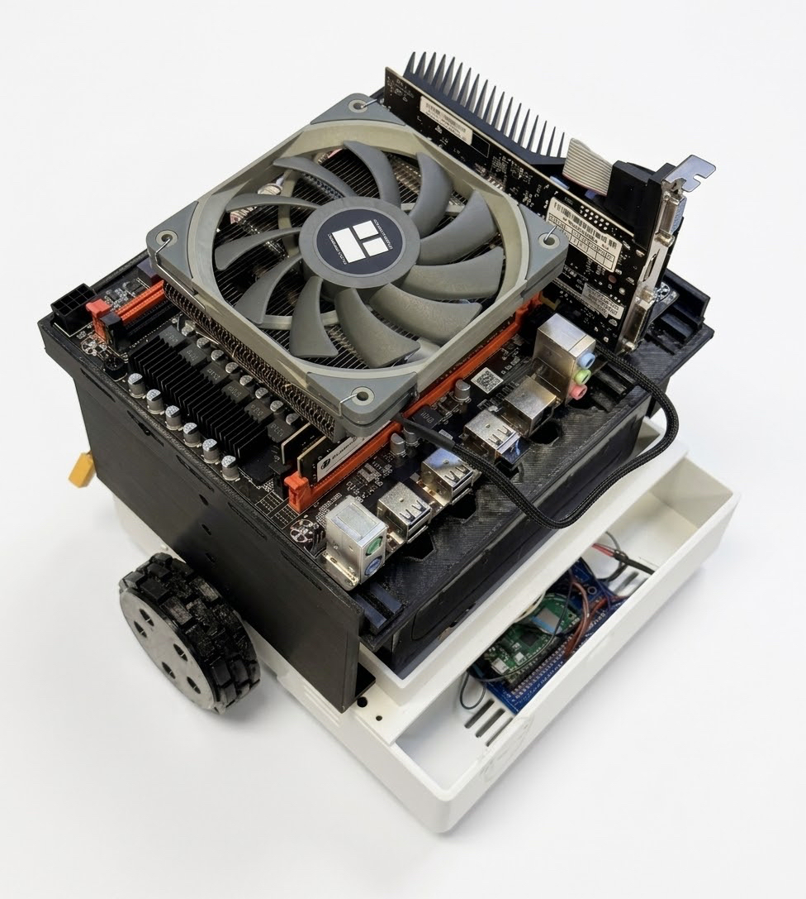

## Members
Danial Syed, Electrical and Computer Engineering Student
danialjsyed@vt.edu

## Mentor

## Current Status
IN PROGRESS (core hardware and AI stack complete, ~2 months of integration left)

## Project Overview

Reedus is a mobile AI assistant: a fully 3D-printed differential-drive robot with a local, offline conversational brain, intent-based object detection, and a hands-free voice interface. This repository holds the chassis CAD and Pico W drive firmware (`ReedusMech/`), the LLM serving stack, knowledge corpus and voice pipeline (`reedus_llm/`), the vision module (`reedus_oj/`), and ReedOS, the control app that runs on the robot and on any phone or laptop on the network (`ReedOS/`).

The brain is a base Qwen2.5-3B-Instruct model running on a CPU-only Xeon inside the robot through llama.cpp. Reedus's personality lives in a system prompt (no fine-tune because the fine-tune route (Mistral-7B LoRA, then QLoRA + DPO on Qwen3-4B) was built and measured, and it degraded the model more than it helped, so it was dropped). Around the base model sits a local sharded Wikipedia/Fandom retrieval corpus, a search router backed by self-hosted SearXNG, a fact-verification layer, persistent memory, and a correction-capture loop. An optional cloud mode swaps the LLM for Gemini and the voice for Inworld.

Object detection is intent-based, the matching YOLO-World vocabulary is loaded lazily, and the detections are sent to the LLM as grounding. Motion is closed-loop per-wheel velocity PI with feedforward plus heading hold, with gains measured on the robot. A forklift attachment and a modular part system are planned once the base robot is complete.

## Educational Value Added

Working on this project expands my technical knowledge by giving me direct experience with computer vision models, quantization, and the full machine learning lifecycle from dataset preparation to deployment. I also learn how to integrate language models with robotics in a way that respects constraints: on a 16 GB CPU-only box, prefill cost, prompt-cache behavior, and thread scheduling decide whether the assistant is usable at all.

It strengthens my skills as an engineer, letting me design modular software systems with event-driven architecture and balance CPU workloads between detection, tracking, speech, and generation. At the same time, I gain exposure to hardware integration, including drivetrain control, PID control loops, power delivery, and sensor fusion.

Most importantly, this project contributes to my growth as a student by pushing me to solve problems under tight resource limits, to think across disciplines, and to prepare myself for future research in robotics and AI. It builds both confidence and capability in solving complex engineering challenges.

## Tasks

- [x] Plan the build and source every component (see BOM)
- [x] Design the chassis in OpenSCAD: tub, battery deck, honeycomb motherboard deck, hubs, TPU tires
- [x] Print and assemble the chassis; mount motors, caster, drivers, Pico W
- [x] Solder things to the Pico W: encoders, BTS7960 drivers, straight-line test
- [x] Characterize the plant (deadband, Kv, tau) and compute PID gains; verify heading hold
- [x] Wireless drive: Pico W TCP link agent with UDP discovery and a motor watchdog
- [x] Deploy Ubuntu Server on the Xeon; native llama.cpp build, conda env, systemd units
- [x] Build the dialogue datasets, run the fine-tune experiments, decide on the base model
- [x] Serving stack: search router, knowledge corpus, grounding/verification, memory, corrections
- [x] Voice: Whisper STT, Kokoro TTS, locally trained "hey Reedus" wake word, barge-in
- [x] Cloud mode: Gemini brain + Inworld voice with budget tracking and fallback
- [x] Vision: household intent taxonomy, lazy YOLO-World model manager, OpenVINO export
- [x] ReedOS: daemon, web/phone app, Tauri shell, routines, camera stream, shared passcode
- [ ] Integrate the Pico PSU so the whole robot runs from the 12 V battery
- [ ] Link object detection to the LLM on the robot end to end
- [ ] Run vision + LLM + voice together on the PID-tuned chassis
- [ ] Post-completion: modular attachment system and forklift arm

## Design Decisions

- **Base model instead of a fine-tune.** Two fine-tuning efforts (Mistral-7B LoRA, then QLoRA + DPO on Qwen3-4B) produced a model that lost the base model's energy, leaked identities from public dialogue data, and degraded safety behavior. The personality now is in the system prompt, which also makes the cloud swap easier. Details in `reedus_llm/reedus_companion/LLM_NOTES.md`.
- **3B over 4B, CPU only.** Qwen2.5-3B at Q4_K_M runs ~6.4 tok/s on the Xeon vs ~4 for the 4B with the persona holding up, and there is no usable GPU on the robot, so the entire stack is llama.cpp, int8 Whisper and CPU Kokoro.
- **Prefill is the latency.** Multi-slot prompt cache, volatile prompt blocks placed after history, chunked history windows, boot-time warming, and a small 1.7B model for the JSON classifier calls.
- **Local knowledge corpus.** A 3B does not know most things, so a sharded, int8, mmapped Wikipedia/Fandom passage store fills the gap, gated so that turns that don't need it don't use it.
- **Self-hosted SearXNG.** One engine gives one snippet per page and that snippet is random; merging engines gives the extractor independent excerpts.
- **Tank/differential drive on a printed chassis.** Two 12 V gearmotors with encoders and a ball caster, all-PETG tub and decks, TPU tires.
- **Honeycomb motherboard deck with floating standoffs.** The X99 board's hole pattern is not published anywhere and the guessed positions didn't fit, so the deck is a hex grid and the standoffs are T-slot rails installed onto the board.
- **Measured PID gains.** A characterization script measures deadband, plant gain and time constant on the robot; gains are computed from those numbers.
- **Safety first in the drive link.** No command within the watchdog window, a dropped TCP client, or a WiFi drop all stop the motors.
- **Locally trained wake word.** "hey Reedus" trained on the build box with openWakeWord instead of paying for a hosted trainer.
- **ReedOS served from the robot.** One URL works on the robot's screen, a phone, or a laptop; one shared passcode for the whole robot.

## Design Misc

- Build box: RTX 3090 Ti, used for training experiments, corpus building, model compilation and wake-word training. Run box: MOUGOL X99 + Xeon E5-2680 v4, 16 GB, Ubuntu Server, OS files on SATA, active run (vision, llm, wakeword) on NVME.
- Chassis footprint 248 x 228 mm. Wheel diameter 80 mm printed, track 150 mm, 100:1 gearboxes, 4400 encoder counts per rev.
- Measured drive constants: Kv = 104 rpm per unit duty, feedforward offset 0.095, tau = 0.081 s; 2.3 rpm mean velocity error and under 0.7 degrees of heading drift over 400 mm.
- Print presets for the TPU tires are in `ReedusMech/print_presets/`; renders and STLs in `ReedusMech/renders/` and `ReedusMech/stl/`.
- Peripherals: EMEET C950 USB camera/mic, Jieli USB DAC speaker, USB WiFi adapter.

## Steps for Documenting Your Design Process

1. Every measured number is next to the code that depends on it as a short comment (gains in `reedus_pid.py`, thread and cache sizing in `config.py` and `xeon.env`).
2. Design rationale for the LLM stack is kept as a single list in `reedus_llm/reedus_companion/LLM_NOTES.md`.
3. Eval runs and profiles are saved under `reedus_llm/eval_runs/` so a change can be compared against the last measurement.
4. Regression tests under `reedus_llm/tests/` and `reedus_oj/vision/tests/`.
6. This README tracks tasks, timeline and the BOM.

## BOM + Component Cost

| Category | Component | Qty | Unit Price ($) | Line Total ($) |
|---|---|---|---|---|
| Core Electronics | MOUGOL X99 + Intel Xeon E5-2680 v4 + 16 GB DDR4 Bundle | 1 | 50.00 | 50.00 |
| Core Electronics | Raspberry Pi Pico W | 1 | 4.00 | 4.00 |
| Core Electronics | LM2596 Buck Converter (5 V regulator) | 1 | 1.89 | 1.89 |
| Mobility | 25 mm 12 V Metal Gearmotor | 2 | 6.58 | 13.16 |
| Mobility | BTS7960 Motor Driver (H-bridge) | 3 | 4.85 | 14.55 |
| Mobility | 65 mm Wheels | 2 | 2.57 | 5.14 |
| Mobility | 4 mm Couplers | 2 | 1.10 | 2.20 |
| Mobility | Ball Caster | 1 | 0.90 | 0.90 |
| Mobility | 3D-Printed Motor Mounts | 2 | 3.00 | 6.00 |
| Chassis & Mounting | 12x18" Cutting Boards (stacked layers) | 2 | 10.47 | 20.94 |
| Chassis & Mounting | Assorted Screws/Standoffs Kit | 1 | 9.99 | 9.99 |
| Chassis & Mounting | Aluminum Sheet (arm base / brackets) | 1 | 15.00 | 15.00 |
| Forklift Arm | 12 V Linear Actuator (100 mm stroke) | 1 | 14.00 | 14.00 |
| Forklift Arm | Guide Rails / Drawer Slides (1 pair) | 1 | 6.00 | 6.00 |
| Forklift Arm | 3D-Printed Fork Platform | 1 | 3.00 | 3.00 |
| Power | 12 V 18 Ah SLA Battery | 1 | 23.00 | 23.00 |
| Power | High Power 300 W DC-ATX Pico PSU (12 V input, 24-pin) | 1 | 11.33 | 11.33 |
| Power | Low-Voltage Cutoff (LVD) Module | 1 | 3.00 | 3.00 |
| Power | Fuse + XT60 Connectors + Wiring (kit) | 1 | 5.00 | 5.00 |
| Power | EPS 8-pin CPU Power Pigtail (12 V) | 1 | 3.00 | 3.00 |
| Power | Mini-Fit Jr 2-pin Input Harness for DC-ATX | 1 | 2.00 | 2.00 |
| | **GRAND TOTAL** | | | **214.10** |

## Timeline

**Core hardware (complete)**
- Planning and sourcing
- Full 3D-printed chassis + drive
- PID-tuned mobility

**AI stack (complete)**
- Ubuntu Server deployment on the Xeon
- Local + cloud LLM suite fully functional
- Intent-based object detection fully functional

**Final core work (next ~2 months)**
- Integrate the Pico PSU for battery power
- Link object detection + LLM
- Run both on the PID-tuned chassis

**Post-completion extension**
- Modular attachment system
- Forklift functionality

## Useful Links

- Repository: https://github.com/Danial-Sy/reedus
- Chassis CAD: `ReedusMech/reedus_chassis.scad`
- Drive firmware: `ReedusMech/reedus_pid.py`, `ReedusMech/reedus_link.py`
- LLM stack: `reedus_llm/reedus_companion/`, notes in `LLM_NOTES.md`
- Vision: `reedus_oj/vision/`
- ReedOS: `ReedOS/`
- Qwen2.5: https://huggingface.co/Qwen/Qwen2.5-3B-Instruct
- llama.cpp: https://github.com/ggml-org/llama.cpp
- openWakeWord: https://github.com/dscripka/openWakeWord
- YOLO-World (ultralytics): https://docs.ultralytics.com/models/yolo-world/
- SearXNG: https://github.com/searxng/searxng
- Kokoro TTS: https://huggingface.co/hexgrad/Kokoro-82M
- faster-whisper: https://github.com/SYSTRAN/faster-whisper

## Log

- **2026-07-16**: Chassis redesigned against the measured motor and caster drawings; epoxy-putty motor cradles, flat caster mount, extended tail.
- **2026-07-27**: Motherboard deck rebuilt as a honeycomb plate with floating standoff pucks after the guessed X99 hole pattern failed to fit.
- **2026-08-03**: Multi-slot prompt cache; warm chit-chat turns went from 18.5 s to 4.8 s.
- **2026-08-09**: Grounding index, correction capture, subject detection and CPU tuning. Topic router and subjects merged; switched search from DuckDuckGo to self-hosted SearXNG.
- **2026-08-10**: Router split measured; the small model kept for cheap classifier calls, the ones it degrades pinned to the main model.
- **2026-08-11**: Prefill work: persona prompt split, better memory, chunked history.
- **2026-08-13**: OpenBLAS llama.cpp rebuild on the Xeon and migration scripts.
- **2026-08-15**: Cloud mode: Gemini 3.7 Flash brain + Inworld voice with spend ledger; corpus disabled in cloud mode after it only added latency there.
- **2026-08-24**: ReedusMech committed: printable parts, drive firmware, measured PID. ReedOS built with the seam to the real Reedus; served from the robot with one shared passcode. "hey Reedus" wake word trained locally.
- **2026-09-11**: Repository cleanup: stale docs removed and README written
